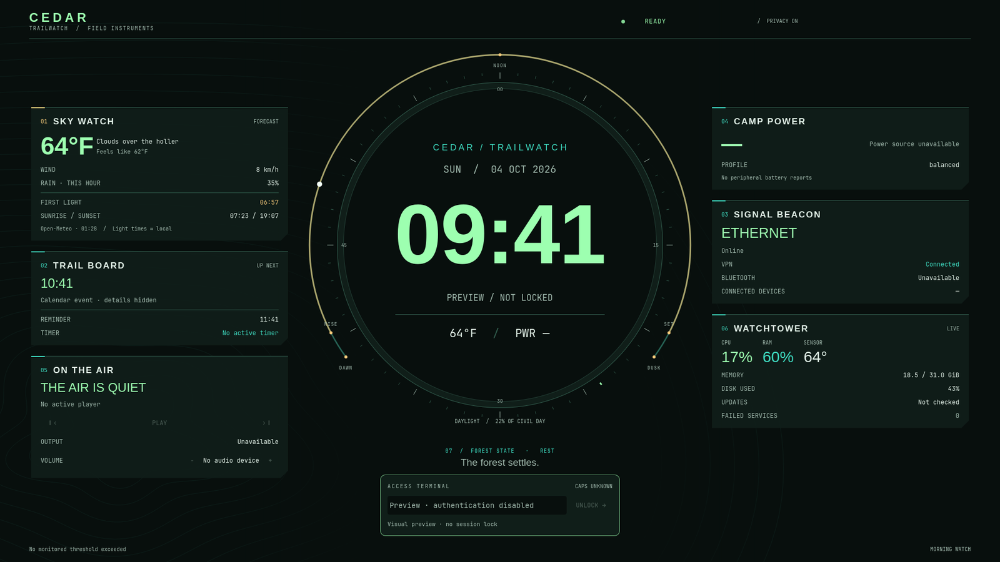
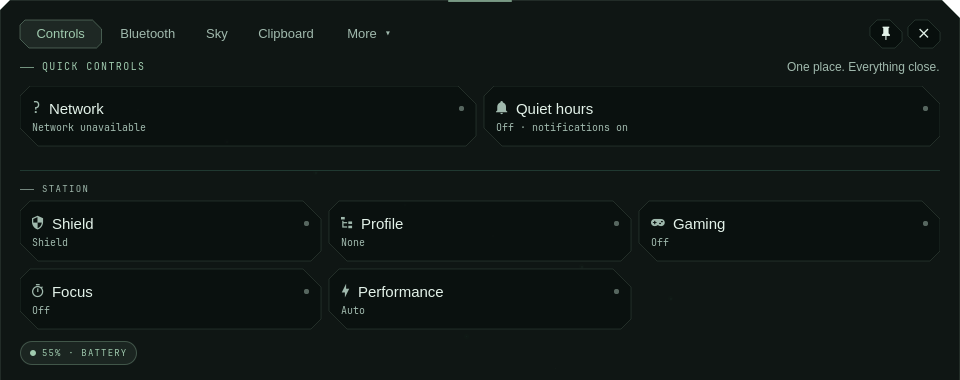
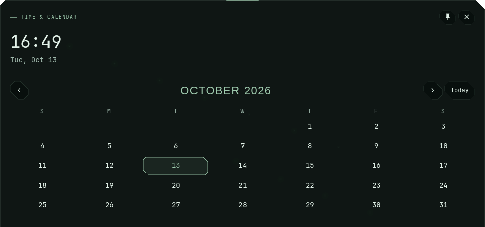
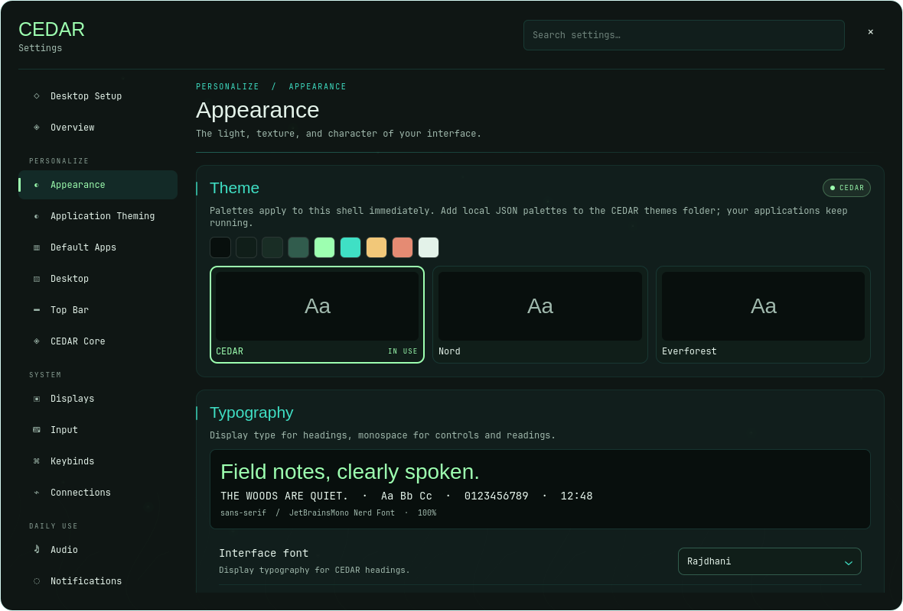

# CEDAR

**A living desktop environment for Hyprland.** *Rooted in faith. Built with care.*



CEDAR is a complete desktop shell for Hyprland: a bar, quick controls, a calendar, searchable settings, notifications, a lock screen, network privacy tools and a Gaming Mode. It works offline and keeps your existing apps, displays and settings.


<p>
  
  
</p>



## Requirements

- Arch Linux, CachyOS or Omarchy on x86_64
- A working Hyprland session

## Install

```bash
git clone https://github.com/EMQOutlaw/Cedar-Shell.git
cd Cedar-Shell
./install.sh
```

`install.sh` installs any missing packages with yay (or pacman if you don't have yay), asking before it does, then opens the CEDAR Installer. The installer shows a plan, changes nothing until you approve it, and backs up everything it touches first.

The packages it installs are listed at the top of [install.sh](install.sh). To manage packages yourself, run `CEDAR_SKIP_PACKAGES=1 ./install.sh`.

## Preferred applications

CEDAR’s choices are **Strata** for files, **Zen Browser** for the web, **kitty**
for the terminal, and **VSCodium** for text and code. In **Settings → Default
apps**, installed choices appear first and have a **Use…** button to set their
associations and CEDAR launchers.

Your existing choices survive installation and updates. When no association is
set, CEDAR can use its installed preferred app; kitty is the first terminal
fallback after your selected terminal, XDG terminal provider and `$TERMINAL`.
These apps are optional and are not downloaded automatically.

## Task Manager

Open **Field Station → Task Manager**, find **CEDAR Task Manager** in your
application launcher, or run `cedar-task-manager`. It opens independently with
live hardware metrics, searchable processes, protected process controls and
user-service inspection. Field Station keeps its existing Overview.

See [Task Manager](docs/TASK-MANAGER.md) for source builds, optional NVIDIA
telemetry, shortcut registration and process-control limitations.

## Update

Open **Field Station → Update CEDAR**, or run:

```bash
~/.local/bin/cedar installer --update
```

## Undo

```bash
~/.local/bin/cedar restore                # go back to your previous desktop
~/.local/bin/cedar installer --uninstall  # remove CEDAR, keep your data and packages
```

Every install leaves a backup in `~/.local/state/cedar/installations/`.

## Learn more

[Installation](docs/INSTALLATION.md) · [Keybinds](docs/KEYBINDS.md) · [Calendar](docs/CALENDAR.md) · [Privacy](docs/PRIVACY.md) · [Shield](docs/SHIELD.md) · [Gaming Mode](docs/GAMING.md) · [Recovery](docs/RECOVERY.md) · [Troubleshooting](docs/TROUBLESHOOTING.md)

## License

The first-party source and artwork are unlicensed by the owner's decision; please do not redistribute them. Upstream notices are in [credits](docs/LICENSES.md).
