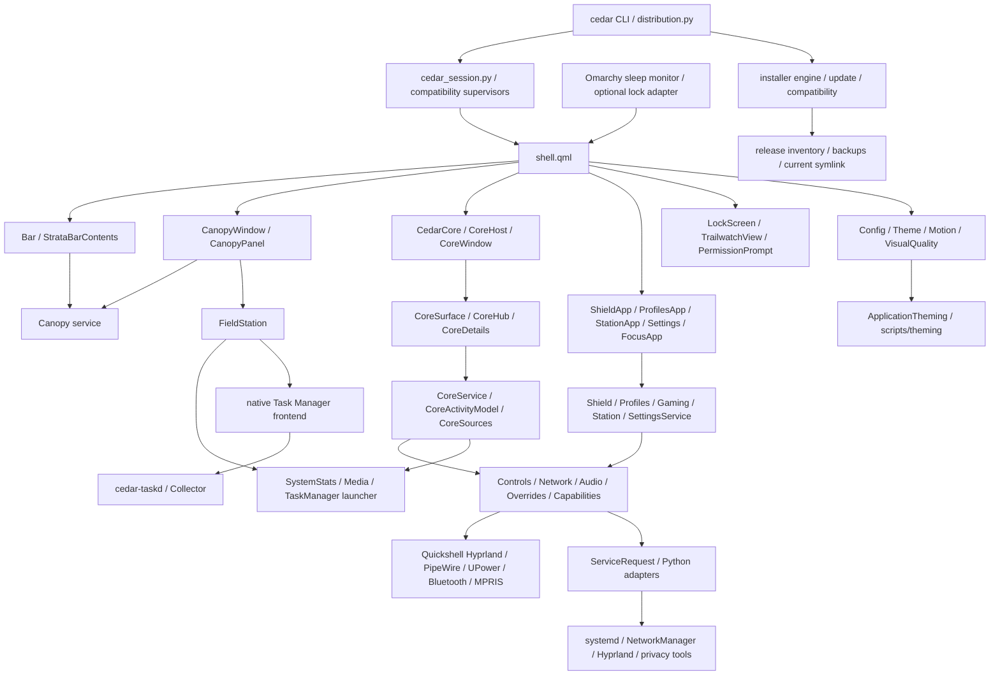

# CEDAR architecture

This map describes the source inspected on 2026-10-20, starting at commit
`058aace7c8da6be810350557a8d65e58077caed3`. It describes ownership and references,
not proof that every feature is active in a particular session. See
[refactoring audit](refactoring-audit.md) for findings and
[performance results](performance-results.md) for measurements and limitations.

## Entry points and installed layout

| Entry point | Responsibility and lifetime |
| --- | --- |
| `shell.qml` | Main Quickshell `ShellRoot`; IPC routes, per-output bars and optional windows, notifications and lock ownership. |
| `scripts/cedar` → `scripts/distribution.py` | Public CLI; install/release verification, activation, trial, recovery and diagnostics. |
| `scripts/cedar_session.py` | Current session start/restart/reconciliation; launches the managed `cedar-shell` unit and handles overlapping Omarchy instances. |
| `scripts/lock_bridge.py`, `scripts/lock_bridge_install.py` | Optional on-demand Omarchy lock IPC adapter and reversible installation helper. The existing Omarchy sleep monitor owns the inhibitor; CEDAR's native lock remains the lock owner. No new daemon. |
| `scripts/portable_session.py`, `scripts/omarchy_session.py` | Compatibility/trial session supervisors and restoration paths. They remain relevant to existing installations. |
| `scripts/cedar-task-manager` → `scripts/task_manager.py` | Launches the matching release's native Task Manager; `execv` replaces Python with `libexec/cedar-task-manager`, or the explicit source-build binary. |
| `wallpaper-picker.qml`, `keymap.qml` | Separate Quickshell tools launched with `--no-duplicate`; their memory is additional to the main shell. |
| `installer/cedar_install.py`, `installer.qml` | CLI/UI installer owner and Quickshell UI. `installer/engine/server.py` is a stdin/stdout JSON-lines protocol, not an HTTP listener. |
| `preview.qml`, `showcase.qml`, `trailwatch-preview.qml`, `auth-test.qml`, `notification-test.qml` | Development/preview entry points; do not count as production runtime unless explicitly running. |

The root `qmldir`, `services/qmldir`, `modules/qmldir` and component registries
are part of the import contract. `data/source-files.json` is the explicit
release inventory. `scripts/distribution.py` installs versioned releases below
`$XDG_DATA_HOME/cedar/releases`, selects one through `cedar/current`, and manages
the `quickshell/cedar` registration and recovery copies. Public launchers,
relative QML imports and release-relative `Quickshell.shellPath()` calls must
continue to resolve together. Moving directories requires coordinated changes
to those contracts, packaging and recovery tests.

## Dependency map

Edges denote direct use or ownership; they do not imply a separate process per
box. In particular, QML services normally share the main Quickshell process.

## Feature ownership and lifecycle

| User-facing feature | Actual source and state owner | Data and permissions | Disable/unload and verification |
| --- | --- | --- | --- |
| Bar, morphs, Living Edge and grain | `modules/Bar.qml`, `StrataBarContents.qml`, `CanopyWindow.qml`; `services/Canopy.qml` owns route, output and anchor state; `components/StrataBarFrame.qml` and `core/StrataGeometry.js` own drawing/geometry | Shared service properties; Hyprland workspace events. No privileged operation just to draw. | One bar per screen; Canopy content follows open/closing lifecycle. `check_strata_bar.py`, `check_canopy.py`, `strata_test.js`. |
| Dynamic Island / Signals | Existing names are Core: `CedarCore.qml` → `core/CoreHost.qml` → `CoreWindow.qml` → `CoreSurface.qml`, `CoreHub.qml`; state in `CoreService`, `CoreActivityModel`, `CoreSources` | Adapts shared media, notifications, network, telemetry, recording/privacy and timers. `core_actions.py` dispatches supported actions. | Single screen-keyed host; heavy hub content unloads on close. `coreEnabled` controls feature. Core/host/persistence/action tests cover portions of behavior. No independent `DynamicIsland` or `Signals` daemon was found. |
| Field Station | `modules/FieldStation.qml` hosted by Canopy's `station` topic or legacy `Hud.qml` | `SystemStats` telemetry, `Media`, task-manager launcher; user-triggered installer route | Visible station drives instrument cadence. Content belongs to host loader. `check_station_tasks.py`, `check_canopy.py`. Distinct from **CEDAR Station**, below. |
| CEDAR Station diagnostics | `StationApp.qml`, `StationPages.qml`, `services/Station.qml` | Reuses `SettingsInfo`, `SystemStats`, `Capabilities`; `scripts/station.py` reads services/logs/config and performs supported explicit service actions | App lazy-loaded while `windowOpen`; snapshots on open/refresh. `check_station.py`. SystemStats cadence is determined by its own consumer predicate; the Station service's old comment must not be taken as a cadence guarantee. |
| Shield | `ShieldApp.qml`, `ShieldPages.qml`, `services/Shield.qml` | `scripts/shield.py`, Proton/Tailscale adapters, Network; selected firewall/DNS/service changes require scoped platform authorization | App loads while open, snapshot refreshes are demand/event driven. Shield and security tests; destructive real controls require an isolated host. |
| Desktop Profiles | `ProfilesApp.qml`, `ProfilesPages.qml`, `ProfileHud.qml`, `services/Profiles.qml`; policy in `core/Profiles.js` | `Controls`, `Overrides`, `Transaction`, Gaming and typed platform operations | Window and transaction HUD load on demand; active profile state persists for restoration. Profile/override tests. |
| Gaming Mode | `services/Gaming.qml`, `GamingHud.qml` | Shared `Controls`/`Overrides`, `scripts/gaming.py`; GameMode watcher only when capability exists; scoped `systemd-inhibit` while configured and active | HUD released after transition; inhibitor is owned by active mode; restore prior settings instead of unconditional resets. Gaming tests and live recovery checks. |
| Task Manager | `taskmanager/*.qml`, `native/taskmanager/frontend.*`, `backend.cpp`, `collector.*`; `services/TaskManager.qml` only launches it | Native process/proc/sysfs collector, same-user local socket protocol, guarded process/service actions | Independent application. Backend cadence is 1 s for visible clients, 5 s for connected hidden clients; no ready clients stops sampling and starts 5 s exit timer. Native collector and task-manager tests. |
| Themes and animations | `Theme.qml`, `Config.qml`, `services/Motion.qml`, `VisualQuality.qml`, `ApplicationTheming.qml`, `components/Breath.qml`, kinetic components | JSON palettes/config watches; `scripts/theming/` adapters and transactional changes to selected application config | Ambient motion rests after 120 s input inactivity; reduced motion and visual quality gate effects. Functional transitions have separate policy. Theme/motion/kinetic tests. |
| Lock, screensaver, authorization | `LockScreen.qml`, `TrailwatchView.qml`, `components/LockAuth.qml`, `services/Trailwatch.qml`, `Permission.qml`; `ShellState` owns lock state | Quickshell session lock/PAM and polkit; external-session status via `SessionIntegration` where configured | Lock objects must survive authentication. External freshness watchdog fails closed after stale supervisor status. Lock/bridge/permission tests plus real compositor/authentication validation. |
| Field Notes | `FieldNotesBoard.qml`, `NotesPaper.qml`, `services/FieldNotes.qml`, pure policy/model in `components/notes/` | Persisted bounded document/history model, export/clipboard adapters; IPC refuses edits while locked | Board intentionally survives closing to keep undo history and pre-open script behavior; only its visible layer surface disappears. Notes JavaScript contracts/lifecycle tests. |
| Updater and installer | `installer/engine/`, `installer/providers/`, `scripts/distribution.py`, `compatibility/` | Source/channel selection, integrity inventory, controlled release selection, backup/journal/restore, narrow package privilege provider | Runs on explicit invocation. Installation/update/rollback/channel tests are required together; unit fixtures do not establish real-host restoration. |

CEDAR Brain is not implemented as a runtime component in this checkout. A
separate Brain process, if deliberately included in a measurement, must be
identified and reported as an additional owner; do not infer it from the word
"brain" in a font name or from an unrelated local project.

## Shared system providers and process ledger

| Capability | Authoritative provider here | Additional processes and cadence |
| --- | --- | --- |
| CPU, memory, network rate, temperature, disk | `services/SystemStats.qml` | In-process `/proc`/hwmon reads with one deadline scheduler. One-time `telemetry.py sensors`; `df` only at the disk cadence. Native Task Manager deliberately has its own independent collector. |
| Audio devices/volume, media | `Audio.qml` via Quickshell PipeWire; `Media.qml` via MPRIS | No volume/media poll process. `AudioInstruments` requests optional processing details. `Pulse` owns one `spectrum.py`/CAVA feed while there is visible demand and motion permits it. |
| Network | `Network.qml` → `scripts/connections.py --watch` | One subscribed NetworkManager helper plus bounded action requests; expanded lists request details; retry backs off to 60 s. |
| Battery and power | Quickshell UPower; `Controls.qml` for power profiles/nightlight; Config also observes Quickshell PowerProfiles | `control.py` snapshots/actions. Polling is now limited to visible quick controls and Settings power consumers, including floating Settings. The native-provider/snapshot overlap remains a consolidation candidate requiring parity checks. |
| Bluetooth | `BluetoothService.qml` → optional Quickshell Bluetooth backend | Discovery is explicit and capped at 30 s; capability-specific action helpers. |
| Windows/workspaces | Quickshell Hyprland objects and signals | `hyprctl` remains for explicit operations/probes, not independent UI heartbeat loops. |
| Notifications | `modules/NotificationServer.qml` and `services/NoticeStore.qml` | One native server; Signals and history consume it. |
| Recording/privacy/keyboard indicators | `CoreProbe.qml` → `scripts/core_probe.py` | Shared Core probe; Trailwatch fallback probe only when Core is disabled and lock view needs it. |
| Default applications/catalog | `DefaultApps.qml` → `scripts/default_apps.py --watch` | One application-info watcher, reused by launcher/settings. |
| Clipboard | `Clipboard.qml` | `wl-paste --watch` invokes `clipboard_item.py` on clipboard changes; stopped while locked/disabled. |
| Session ownership | `cedar_session.py`; compatibility supervisors where selected | `cedar-theme-guard.path` activates bounded reconciliation service; not a permanent timer daemon. |
| Omarchy suspend locking | Existing `omarchy-sleep-lock.service` with optional `lock_bridge.py` adapter | Monitor retains its inhibitor and deadline. Adapter and bounded `qs` clients run only on lock/status requests; stock boot-lock ownership takes precedence. Install-only helper never activates services or edits lid bindings. |
| Weather/calendar | `Weather`, `WeatherLocation`, `CalendarFeeds` | Configured fetches have separate weather/location/calendar freshness needs; do not merge their privacy or offline policies. |

Count detached tools, Task Manager/backend, inhibitors and selected compatibility
supervisors in addition to shell descendants. Exclude applications merely
launched by the app launcher and platform daemons such as Hyprland,
NetworkManager and PipeWire; report relevant platform/GPU costs separately.
Never classify an entire broad user cgroup as CEDAR without checking its members.

## Coupling, duplication and boundaries

The baseline contains 250 tracked QML files, 31 JavaScript files (including
tests), and 45 registered singletons. Directory imports are broad: modules
import services/components/root; services import root and shared components;
some components import services and `SettingsBarPreview.qml` imports modules.
These are convenience import boundaries, not clean independent packages.

There are real reference cycles: `ShellState` routes to `SettingsService` and
`Canopy`, which both read/write `ShellState`; Config drives Theme bindings and
reads `VisualQuality`, which reads Config and Gaming. Such reference cycles do
not by themselves prove a QML binding loop. State ownership must be retained
when narrowing them: routing belongs to ShellState/feature controllers, saved
preferences to Config, computed styling to Theme/VisualQuality, temporary
transaction overrides to Overrides. Do not introduce a competing event bus or
second configuration singleton merely to hide these dependencies.

Two wallpaper UIs remain reachable: the in-shell `modules/WallpaperPicker.qml`
and separate `tools/wallpapers/WallpaperGrid.qml`. Their Python wrappers both
use `desktop_runtime` for library/application behavior, but preview cache,
keyboard behavior and window ownership differ. Share proven thumbnail/data
primitives after comparing those behaviors; do not delete either route as
"duplicate". Similar legacy ControlCenter/PowerMenu/Hud surfaces are explicit
fallbacks when Canopy is disabled.

The independent Task Manager duplicates some `/proc` reads by design so it can
diagnose a failed shell. Consolidating its process into the shell would trade
fault isolation for a hypothetical saving. Share pure parsing/policy only where
language and behavior allow it, and measure concurrent use before changing this.

Large components worth focused review are `FieldNotesBoard.qml` (1108 baseline
lines), `NotesPaper.qml` (847), `GoCanopy.qml` (824), `ShieldPages.qml` (692),
`Go.qml` (599), `CoreSources.qml` (587), and `FieldStation.qml` (543). The launcher
service combines application search, menu navigation, dmenu prompts and action
dispatch; the Core adapter aggregates many distinct producers. Pure note model,
geometry and history code already live separately. Line count alone is not
evidence that another split improves runtime cost.

A tracked-source name-reference scan found no proven unused QML type under
`components/`, `modules/` or `services/`, excluding documentation, test files,
registries and the source inventory as evidence. This is a conservative static
check, not reachability proof: imports, generated data, previews and external IPC
can affect use. No code was removed on the basis of this scan.
